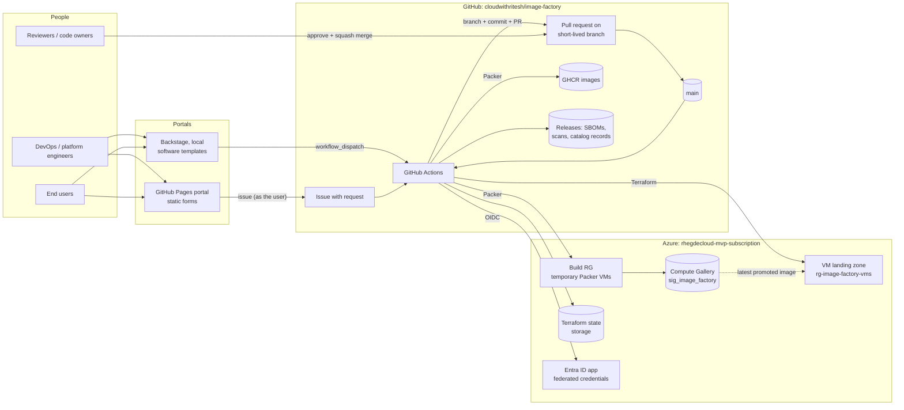
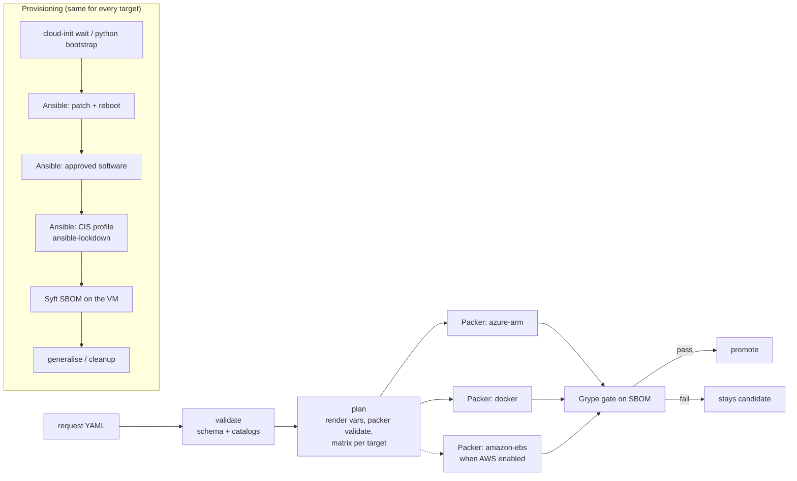

# Architecture

The Image Factory builds hardened **golden images** for Azure, AWS and Docker
from one repository, and lets teams request **VMs** built from those images
through a self-service portal. Every change, whether an image or a VM, is a
file in Git that reaches `main` through a reviewed pull request.

- How changes flow, step by step: [workflow.md](workflow.md)
- How to set up and operate it: [instructions.md](instructions.md)
- Naming rules for branches, commits and PRs: [standards.md](standards.md)
- CIS deviations: [hardening-exceptions.md](hardening-exceptions.md)

---

## 1. Principles

| Principle | What it means here |
|---|---|
| **Everything is a file in Git** | Images are `requests/<name>.yaml`, VMs are `vms/<name>.yaml`. The portals never call Packer, Terraform or a cloud API; they only propose files. |
| **Every change is a reviewed PR** | Short-lived branch → standard commit → PR → approval → squash merge. Git history is the audit log. |
| **Catalogs are the contract** | `catalog/*.yaml` define what can be requested. The validator, both portals and the pipeline all read the same files, so a form can't offer what the pipeline would reject. |
| **No stored cloud secrets** | GitHub Actions authenticate to Azure (and AWS) with OIDC. Trust is limited to this repo's `main` branch and named environments. |
| **Same scripts, any CI** | The logic lives in `scripts/`, `packer/`, `ansible/` and `terraform/`. GitHub Actions (now) and GitLab CI (later) are thin wrappers around them. |
| **Nothing ships unscanned** | Images start as *candidates*. Only images that pass the vulnerability gate are promoted, and VMs can only use promoted images. |

---

## 2. System context

---

## 3. Components

### 3.1 Request model

| File | Schema | Written by | Consumed by |
|---|---|---|---|
| `requests/<name>.yaml` (kind `ImageRequest`) | `schemas/image-request.schema.json` | portals, or by hand on a `feat/…` branch | `scripts/imagefactory.py` → Packer + Ansible |
| `vms/<name>.yaml` (kind `VirtualMachine`) | `schemas/vm-request.schema.json` | portals | `scripts/portal/vm_tfvars.py` → `terraform/vm/azure` |

Catalogs (the "menu"):

| Catalog | Defines |
|---|---|
| `catalog/os.yaml` | Base image per OS per target (marketplace image, AMI filter, Docker base) |
| `catalog/hardening.yaml` | Hardening profiles per OS and kind (VM/container), with the default |
| `catalog/software.yaml` | Approved software: `apt` packages, checksum-verified `url` downloads, repo `file`s; each limited to OSes and targets |
| `catalog/vm.yaml` | Enabled clouds, regions, t-shirt sizes, environments, disk limits |

Validation happens in layers: JSON schema → catalog cross-checks (OS has
the target, software fits OS and target, profile exists, cloud enabled,
size/region allowed, image approved for that cloud) → naming standards. It
runs in the portal processor, in the PR checks (`validate_all.py`) and
again just before use.

### 3.2 Portals

| | GitHub Pages portal | Backstage (local) |
|---|---|---|
| Code | `portal/pages/index.html` (single static page) | `portal/backstage/` (templates, org, config overlay) |
| Data | `data/catalog.json`, generated at deploy by `scripts/portal/render.py pages` | templates generated by `render.py backstage` (committed; CI checks they're current) |
| Submits | a GitHub **issue** as the signed-in user, carrying the form as JSON | `github:actions:dispatch` of `portal-request.yml` with the form as JSON |
| Identity | GitHub session | GitHub OAuth now; Entra ID later |
| Hosting | GitHub Pages (`portal-pages` workflow) | developer machine (`yarn start`) |

Both send the **same flat form JSON**. Only the request processor maps it
to request documents, so adding a third front end (for example an Entra
ID-protected web app) means sending the same JSON.

### 3.3 Request processor

`.github/workflows/portal-request.yml` + `scripts/portal/`:

| Module | Responsibility |
|---|---|
| `process_request.py` | Read the issue or dispatch payload; reject untrusted issue authors (only OWNER/MEMBER/COLLABORATOR); validate names before using them in paths; map form → request document (merging into an existing file for updates); validate; write the file; build branch name, commit message (with trailers) and PR body |
| `standards.py` | Single definition of the branch and title patterns; generates portal names, checks PRs |
| `open_pr.sh` | Create the branch, regenerate the Backstage templates, commit as the bot, push, open the labelled PR |
| `validate_all.py` | Validate every request and VM file (PR checks) |
| `render.py` | Generate portal data and Backstage templates from the catalogs |
| `vm_tfvars.py` | VM file → Terraform variables (re-validates first) |
| `test_portal.py` | Regression tests, including the security rejections |

Bot identity: a **GitHub App** (recommended; its PRs trigger the normal
checks) or the workflow `GITHUB_TOKEN` (fallback). GitHub won't run
`pull_request` workflows for PRs opened with `GITHUB_TOKEN` without an
"Approve and run" click, so `start_pr_checks.sh` dispatches `pr-standards`
and `image-factory` (lint + plan) on the PR branch; their check runs land on
the PR's head commit and satisfy the required checks.

### 3.4 Image pipeline

| Stage | Tool | Output |
|---|---|---|
| Template | Packer, one template per OS family: `packer/linux` (one `build`, sources `amazon-ebs`, `azure-arm`, `docker`; SSH) and `packer/windows` (`amazon-ebs`, `azure-arm`; WinRM over HTTPS, sysprep / EC2Launch) | identical provisioning on every target of a family |
| Configuration | Ansible: `ansible/image.yml` (Linux; roles `base` and `software` pick apt / dnf / zypper from the OS's `pkg_family`) and `ansible/windows.yml` (Windows Update, Chocolatey, files); hardening role from `requirements.yml` | patched, configured, hardened image; `build-info.json` inside |
| Hardening | ansible-lockdown CIS roles: **UBUNTU24-CIS 1.8.0**, **RHEL9-CIS 2.4.2** (RHEL, Rocky), **AMAZON2023-CIS 1.5.0**, **Windows-2022-CIS 4.2.0**; in-repo `baseline` (Fedora, SLES, containers) and `openshift` | per-OS profiles in `catalog/hardening.yaml`; deviations in `hardening-exceptions.md` |
| SBOM | **Syft 1.55.0**: on the build VM after hardening; from the registry for Docker | CycloneDX + SPDX JSON |
| Vulnerability gate | **Grype 0.120.0** on the SBOM, fail at `fail_on_severity` (default critical), `--only-fixed` | pass marker required for promotion |
| Publish (candidate) | Azure: gallery version with `excludeFromLatest=true`, in a definition named after the request (created on first build). Docker: `:candidate-<version>` | |
| Promote | Azure: include in latest, tag `Status=approved`, `SbomUrl`. Docker: `<version>` + `latest` tags. AWS: tag, share, SSM `/image-factory/<name>/latest` | release `<name>-<version>` with SBOMs, scan report, catalog record |

**Version scheme:** `YYYY.(MM*100+DD).<run number>` (e.g. `2026.1104.12`).
It's valid semver for Azure galleries and the same for every target in
one run.

### 3.5 VM provisioning

One module per cloud, one state file per VM (`vms/<name>.tfstate`), the
same request fields for both. `vm-provision` picks the module from the
request's `cloud`.

**Azure** (`terraform/vm/azure`, state in the factory's Azure storage):

- **Image:** `azurerm_shared_image_version` with `latest` (newest promoted) or
  a pinned version. A postcondition requires `Status=approved`, so a pinned
  candidate that never passed the scan is refused.
- **Pinning:** the resolved image ID is stored in `terraform_data.image`. A
  newer `latest` does **not** rebuild a running VM; changing `image` or
  `image_version` in the request **does** (deliberately).
- **Network:** a NIC on the shared workload subnet. Each VM has **its own
  NSG** on its NIC: default rules (VNet in, internet out) plus SSH from the
  requested range when it has a public IP (a /16 or narrower range is required).
  The subnet has no NSG, because Azure requires inbound traffic to be allowed by
  both subnet and NIC NSGs.
- **Access:** SSH key only (no passwords), system-assigned identity, managed
  boot diagnostics.
- **Lifecycle:** `state: present` → apply; `state: absent` → destroy. The file
  stays as a record; deleting it does nothing (the workflow warns).

**AWS** (`terraform/vm/aws`, state in the factory's S3 bucket):

- **Image:** the AMI ID from the SSM catalog the promote job writes
  (`/image-factory/<image>/latest` or `/versions/<version>`), so only promoted
  AMIs can be used; a postcondition also checks the AMI's `Status=approved`
  tag and refuses Windows AMIs.
- **Pinning:** as on Azure, via `terraform_data.image`.
- **Network:** the workload VPC from `terraform/factory/aws` (two AZs).
  Private subnet by default (outbound through the NAT gateway); public
  subnet with a public IP only when requested, with SSH from the requested
  range. One security group per instance: all traffic from inside the VPC,
  SSH from the range, all outbound.
- **Access:** SSH key (an EC2 key pair per VM, plus a cloud-init user with
  the requested name), IMDSv2 only, and an instance profile with
  `AmazonSSMManagedInstanceCore`, so Session Manager works without SSH or a
  public IP.
- **Disk:** gp3 root volume encrypted with the factory KMS key.
- **Guardrail:** the `image-factory-vm-provision` role trusts `main` only and
  may change only resources tagged `ManagedBy=image-factory`.

### 3.6 Foundation (Terraform, applied once by the deploy script)

| Module | Creates |
|---|---|
| `terraform/factory/azure` | `rg-image-factory-gallery` + gallery `sig_image_factory`; `rg-image-factory-build`; VM landing zone `rg-image-factory-vms` + VNet `10.60.0.0/16` + subnet `snet-workloads`; Entra app `image-factory-ci` + service principal + **federated credentials**; Contributor on the three RGs; Storage Blob Data Contributor on the state account |
| `terraform/factory/aws` | GitHub (immutable subjects) / GitLab OIDC trust; IAM roles `image-factory-packer` (build + promote; main and `images-aws(-approval)`) and `image-factory-vm-provision` (main only, tag-scoped); KMS key for shareable encrypted AMIs; build VPC `10.250.0.0/20`; workload VPC `10.70.0.0/16` (public + private subnets in two AZs, optional NAT gateway); instance profile `image-factory-instance` (SSM) |
| bootstrap scripts | `deploy-github-azure.sh`: state storage `rg-image-factory-tfstate` / `stimgfac<hash>` (versioned blobs). `deploy-github-aws.sh`: S3 bucket `image-factory-tfstate-<account>-<region>` (versioned, encrypted, TLS-only, S3 native locking) |

---

## 4. Security model

| Concern | Control |
|---|---|
| Cloud credentials | None stored. OIDC federation: GitHub → Entra ID (and AWS IAM). Repos created after 2026-07-15 use **immutable subjects** `repo:<owner>@<owner_id>/<repo>@<repo_id>:…`, so a renamed or recycled repo name can't inherit trust. |
| Who can trigger cloud changes | Only workflows on `main` (`ref:refs/heads/main`) and in the environments `images-<target>` / `images-<target>-approval`. PRs and forks get no cloud access. On AWS, image builds and VM provisioning use separate roles. |
| Who can submit portal requests | Issues: only OWNER/MEMBER/COLLABORATOR (checked in the workflow `if` **and** in the processor). Backstage: users with a GitHub token that can dispatch workflows. |
| Untrusted input | The issue body is read from the event file, never interpolated into shell. Names are pattern-checked before being used in paths. Everything is schema- and catalog-validated. |
| Change approval | Ruleset on `main`: PR required, 1 approval incl. CODEOWNERS, required checks `pr-standards` + `lint` + `plan`, linear history, no force-push or deletion. **No bypass, admins included**: the merge button stays disabled until approval and green checks. |
| Least privilege | CI identity: Contributor on the factory RGs only (not the subscription); blob data access on the state account only. Workflows default to a read-only token; jobs request what they need. |
| Supply chain | Tool versions pinned in `ci/versions.env`, downloads checksum-verified; Packer plugins and the CIS role pinned; SBOM for every image. |
| Image trust | Candidates are excluded from `latest`; promotion requires the scan pass marker; VMs refuse unapproved versions. |
| Network exposure | Build VMs: SSH only from the runner's IP (Packer temporary rules). Workload VMs: private by default; public SSH needs an explicit, narrow CIDR. |
| Hardening | CIS Level 1 by default; every deviation documented in `hardening-exceptions.md`. |

---

## 5. Where things live

| Artifact | Location |
|---|---|
| Azure images | `sig_image_factory/<image-name>/<version>` (rg-image-factory-gallery) |
| Docker images | `ghcr.io/cloudwithritesh/image-factory/images/<name>:<version>` |
| SBOMs, scan reports, catalog records | GitHub release `<name>-<version>` |
| Image build info | `/etc/image-factory/build-info.json` (Linux) or `C:\ProgramData\image-factory\build-info.json` (Windows) inside every image |
| Pipeline logs | workflow artifacts: `output-<image>-<target>/logs/`, `logs-promote-*`, `logs-vm-*`, `logs-portal-request-*` ([logging.md](logging.md)) |
| Terraform state | `stimgfac…/tfstate`: `image-factory/azure.tfstate`, `vms/<name>.tfstate` |
| Platform settings | GitHub repository variables (`PKR_VAR_*`, `AZURE_*`, `VM_*`, `TF_STATE_*`) |
| Portal | https://cloudwithritesh.github.io/image-factory/ |

### 5.1 Operating systems

The catalog offers each vendor's **latest** stable major release and the
**previous** one (N and N-1), so existing images keep building while teams
move up. Every build starts from the newest patched base image of that
release and applies all updates on top. `base-images` (weekly) checks that
every base image below still resolves.

| OS (catalog key) | Release | AWS | Azure | Docker base | Default hardening (VM / container) |
|---|---|---|---|---|---|
| `ubuntu-2604` | latest | ✓ | `Canonical:ubuntu-26_04-lts:server` | `ubuntu:26.04` | CIS L1 (0.9.0 role) / baseline |
| `ubuntu-2404` | previous | ✓ | `Canonical:ubuntu-24_04-lts:server` | `ubuntu:24.04` | CIS L1 / CIS L1 container |
| `rhel-10` | latest | ✓ (PAYG) | `RedHat:RHEL:10-lvm-gen2` | UBI 10 | CIS L1 / baseline |
| `rhel-9` | previous | ✓ (PAYG) | `RedHat:RHEL:9-lvm-gen2` | UBI 9 | CIS L1 / baseline |
| `ubi10-openshift` | latest | | | UBI 10 (UID 1001) | – / openshift |
| `ubi9-openshift` | previous | | | UBI 9 (UID 1001) | – / openshift |
| `rocky-10` | latest | ✓ | (marketplace plan needed) | `rockylinux:10` | CIS L1 / baseline |
| `rocky-9` | previous | ✓ | (marketplace plan needed) | `rockylinux:9` | CIS L1 / baseline |
| `amazonlinux-2023` | latest | ✓ | | `amazonlinux:2023` | CIS L1 / baseline |
| `fedora-45` | latest | ✓ | (no official image) | `fedora:45` | baseline / baseline |
| `fedora-44` | previous | ✓ | (no official image) | `fedora:44` | baseline / baseline |
| `sles-16` | latest | ✓ (PAYG) | `SUSE:sles-16-0-basic-x86-64:gen2` | SLE BCI 16.0 | baseline / baseline |
| `sles-15` | previous | ✓ (PAYG) | `SUSE:sles-15-sp7:gen2` | SLE BCI 15.7 | baseline / baseline |
| `windows-2025` | latest | ✓ | `MicrosoftWindowsServer:WindowsServer:2025-datacenter-azure-edition` | | CIS L1 / – |
| `windows-2022` | previous | ✓ | `MicrosoftWindowsServer:WindowsServer:2022-datacenter-azure-edition` | | CIS L1 / – |

The OS entry's `family` picks the Packer template and `pkg_family` the
package manager (apt, dnf, zypper, Chocolatey). Adding an OS is a catalog
change plus, if needed, a hardening vars file; see
[instructions.md](instructions.md#add-an-operating-system).

### 5.2 Logging

All scripts log through `scripts/ci/log.sh` / `scripts/factorylog.py`:
readable console lines plus JSON lines (`events.jsonl`) carrying a
correlation ID, run, job, image, version, target and portal request ref.
Tool logs (Packer, Ansible, Grype, Terraform) are kept per job, uploaded
even on failure, and `triage.py` writes the likely cause of a failure into
the run summary. Details: [logging.md](logging.md).

---

## 6. Multi-platform design

| Concern | GitHub Actions (active) | GitLab CI (ready) |
|---|---|---|
| Pipeline | `.github/workflows/*.yml` | `.gitlab-ci.yml`, `.gitlab/ci/image-jobs.yml` |
| Fan-out | job matrix | dynamic child pipeline |
| Tools | `setup-tools` action (`ci/versions.env`) | toolbox image (`ci/Dockerfile`) |
| Cloud login | `azure/login`, `configure-aws-credentials` | ID tokens exchanged in `scripts/ci/lib.sh` |
| Registry / storage | GHCR / releases | GitLab registry / generic packages |

Terraform can trust both platforms at once (set `github_repository` and
`gitlab_project_path`), so a migration can run in parallel. State lives in
Azure, independent of the CI platform.

---

## 7. Key decisions

| # | Decision | Why | Trade-off |
|---|---|---|---|
| 1 | Portals propose files; CI does the work | auditability, one path for UI and Git users, review gate | requests aren't instant (review + pipeline) |
| 2 | Open source only (no HCP Packer/Terraform) | requirement; no SaaS dependency | own catalog (gallery tags, SSM, releases) instead of HCP channels |
| 3 | Ansible + ansible-lockdown for CIS | maintained, per-control toggles, container mode | some controls need overrides (documented) |
| 4 | Syft + Grype | open source, standard formats, minimal effort | DB downloads at scan time |
| 5 | One gallery definition per image request | unambiguous `latest` per image | definitions created by the pipeline, not Terraform |
| 6 | GitHub Pages portal + local Backstage | Pages: free, zero-ops, reachable; Backstage: path to an internal developer portal | Pages forms can't do server-side lookups (data is pre-generated) |
| 7 | Issue-based submission for Pages | no server, no tokens in the browser, the user's own identity | user clicks "Submit new issue" once |
| 8 | Per-VM Terraform state | blast radius of one VM, parallel applies | many small state files |
| 9 | Per-VM NIC NSG, no subnet NSG | per-VM SSH policy actually works | NSG count grows with VMs |
| 10 | Image pinned per VM | no surprise rebuilds | VMs need deliberate re-image to pick up new images |

---

## 8. Known limitations and roadmap

- AWS: AMI builds and EC2 self-service are implemented; they go live when
  `scripts/bootstrap/deploy-github-aws.sh` has run and its PR (which sets
  `clouds.aws.enabled: true`) is merged.
- Only Ubuntu 24.04 has produced images through the pipeline so far; treat
  the first image of every other OS as a pilot and review it before wide use.
- Self-service VMs are Linux only: Windows VMs need a credential flow
  (e.g. password in Key Vault, Entra login) before `terraform/vm/azure` can
  create them.
- OpenShift nodes (RHCOS) are managed by the cluster; the factory builds
  OpenShift-ready container base images, not node images.
- Backstage: Entra ID sign-in and hosting (e.g. Azure Container Apps).
- Hosted runners reach build VMs over public IPs (restricted to the runner);
  self-hosted runners in the build network give fully private builds.
- A failed build still opens an approval request for manual promotion; the
  job then skips.
