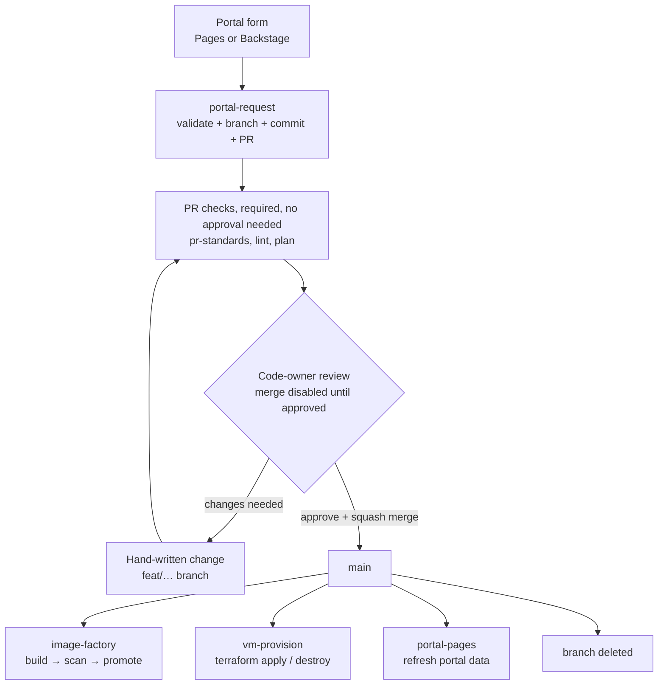
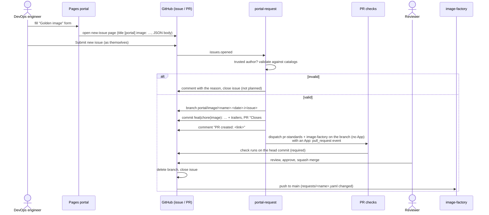
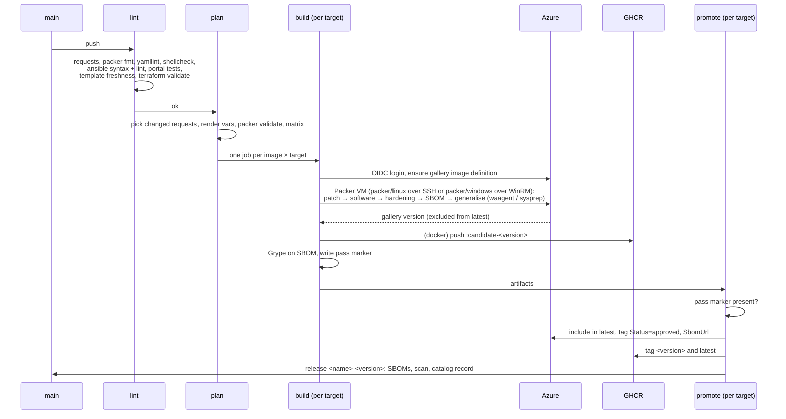
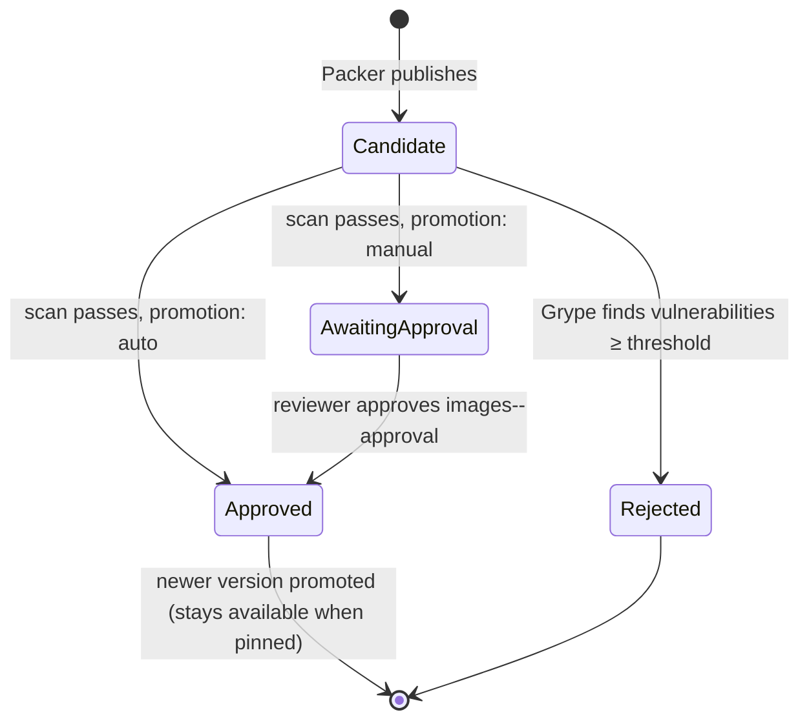
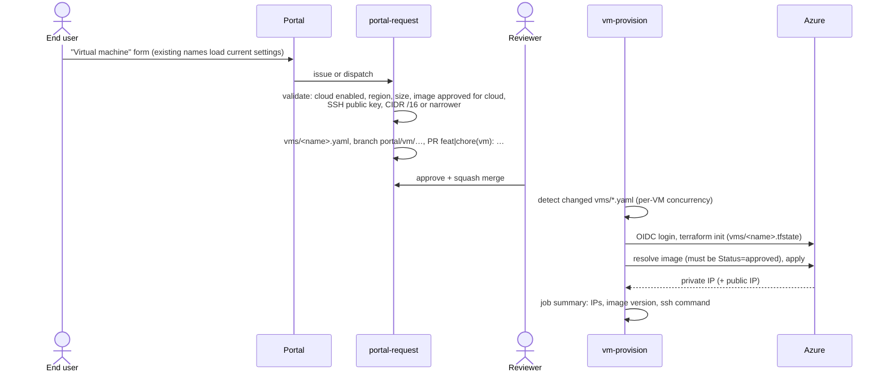
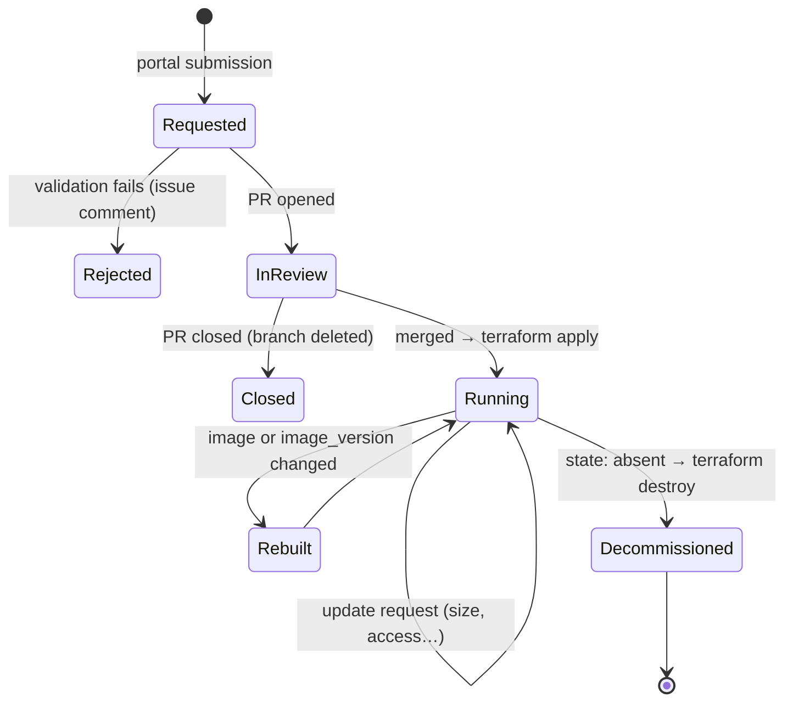

# Workflows

How a request travels from a form to a running image or VM, and what each
GitHub Actions workflow does. Architecture: [architecture.md](architecture.md).
Operating guide: [instructions.md](instructions.md).

---

## 1. Overview

---

## 2. Workflow reference

| Workflow | Triggers | Jobs | Cloud access | Concurrency |
|---|---|---|---|---|
| `portal-request.yml` | `issues: opened` (portal issues from owners/members/collaborators); `workflow_dispatch` (Backstage) | `request`: process → re-check → branch/commit/PR → start PR checks (no App) → reply on the issue | none | one group per submission |
| `pr-standards.yml` | `pull_request` (opened, edited, synchronize, reopened); `workflow_dispatch` (`pr`, started by portal-request) | `pr-standards`: branch, title, commit subjects; validate all requests and VMs | none | per PR, newer cancels older |
| `image-factory.yml` | push to `main`; PRs; monthly schedule (`23 18 1 * *` UTC = 02:23 SGT on the 1st); `workflow_dispatch` (`image_request`, `rebuild_all`, `debug`) | `lint` → `plan` → `build` (matrix: image × target, Linux or Windows template) → `promote` (matrix, environments) | build/promote on `main` only | PRs: per branch, newer cancels older; `main`/dispatch: one group per run (nothing dropped) |
| `vm-provision.yml` | push to `main` touching `vms/**`; `workflow_dispatch` (`vm`, `debug`) | `detect` → `apply` (matrix per VM) | yes | per VM |
| `portal-pages.yml` | push to `main` touching catalogs, requests, VMs, portal or scripts; `workflow_dispatch` | `build` (render data) → `deploy` (GitHub Pages) | none | `pages` |
| `branch-cleanup.yml` | `pull_request: closed` without merge, branch `portal/…` | delete the branch | none | |

---

## 3. Golden image request

### 3.1 From the GitHub Pages portal

### 3.2 From Backstage

Same as 3.1, but the template calls `workflow_dispatch` on
`portal-request.yml` with `kind`, `payload` (form JSON), `requested_by`
(the Backstage user) and `source: backstage`. The branch ref is
`r<run id>` instead of `i<issue>`, and there is no issue to reply to: the
template's output links to the PR list and the run.

### 3.3 Build, scan and promote (after merge)

Which images build:

| Event | Images |
|---|---|
| Push to `main` | requests added or changed in that push |
| `workflow_dispatch` with `image_request` | the listed request file(s) |
| `workflow_dispatch` with `rebuild_all`, or the monthly schedule | every request (patch rebuild) |
| Pull request | none (lint + plan only) |
| `workflow_dispatch` on a non-`main` branch (portal PR checks) | none (lint + plan of the PR's request only) |

### 3.4 Image version lifecycle

`latest` always means the newest **approved** version. Candidates and
rejected versions can't be selected by VMs.

---

## 4. VM request

### 4.1 Create or update

### 4.2 Decommission

Choose **Decommission** in the portal. The request sets `state: absent`,
the PR title is `chore(vm): decommission vm <name>`, and after merge
`vm-provision` runs `terraform destroy`. The file stays in `vms/` as a
record. Deleting a VM file does **not** delete the VM (the workflow warns).

### 4.3 VM lifecycle

---

## 5. Naming at each step

| Step | Name |
|---|---|
| Issue (Pages) | `[portal] image: <name>` / `[portal] vm: <name>` |
| Branch | `portal/image/<name>-<YYYYMMDD>-i<issue>` or `…-r<run>` |
| Commit and PR title | `feat(image): add image <name>` · `chore(image): update image <name>` · `feat(vm): create vm <name> on <cloud>` · `chore(vm): update vm <name> on <cloud>` · `chore(vm): decommission vm <name>` |
| Commit trailers | `Requested-by: @<user>`, `Request-source: pages\|backstage`, `Request-ref: i<issue> \| r<run>` (in the commit and at the end of the PR body, so the squash commit keeps them) |
| Labels | `portal` + `image-request` or `vm-request` |
| Merge | squash, PR title as the commit |
| Image version | `YYYY.(MM*100+DD).<run>` |
| Release | `<name>-<version>` |

People's branches: `<type>/<short-name>` (e.g. `feat/rhel9-support`).
Full rules: [standards.md](standards.md).

---

## 6. Failure paths

| Where | What happens | Who sees it |
|---|---|---|
| Portal validation | Issue comment with the reason; issue closed as "not planned" | requester |
| Untrusted issue author | Workflow job skipped; nothing created | (silent by design) |
| `pr-standards` | PR check fails with the rule that was broken | PR author |
| `lint` / `plan` | PR or `main` run fails; nothing is built | PR author / platform team |
| Packer build | Build job fails; `triage.py` puts the likely cause in the run summary; logs uploaded (`output-*/logs/`); no promotion | platform team |
| Vulnerability gate | Job fails; image stays a candidate (excluded from latest) | platform team |
| Promotion | Skipped with a warning when the pass marker is missing | platform team |
| VM apply | Job fails with a triage summary; logs in `logs-vm-<name>`; state per VM, so other VMs are unaffected | platform team, requester (via the PR's merge commit) |
| Windows image chosen for a VM | Portal hides it; the processor rejects it (Linux VMs only for now) | requester |
| VM with an unapproved pinned version | Terraform postcondition error | requester |

---

## 7. Scheduled and manual operations

| Operation | How |
|---|---|
| Monthly patch rebuild of every image | automatic (schedule); or Actions → image-factory → Run workflow → `rebuild_all` |
| Rebuild one image | Run workflow → `image_request: requests/<name>.yaml` |
| Re-apply one VM (drift, retry) | Actions → vm-provision → Run workflow → `vm: <name>` |
| Refresh the portal | automatic on merge; or Actions → portal-pages → Run workflow |
| Re-run with verbose logs | Run workflow → `debug: true` (image-factory, vm-provision), or re-run a job with "Enable debug logging"; see [logging.md](logging.md) |
| Start PR checks by hand (portal PR, checks missing) | Actions → pr-standards → Run workflow on the PR branch with `pr: <number>`; Actions → image-factory → Run workflow on the PR branch |
